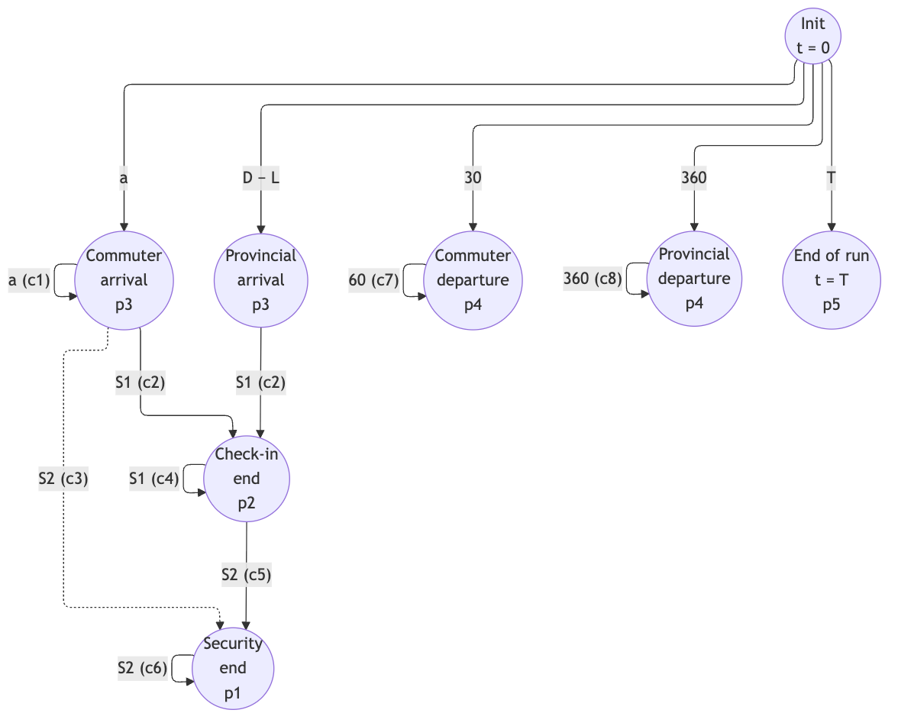
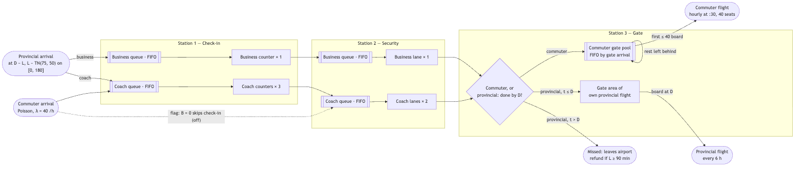

# DES Diagrams

Two views of the same model. The **event graph** is the formal DES
representation: each node is one event routine in `airport_sim/model.py`
(see the mapping table below). The **process-flow view** shows the same logic
from a passenger's point of view.

Sources are Mermaid files in `docs/diagrams/`; the PNG/SVG files in
`docs/figures/` are rendered from them (see "Re-rendering" at the end).

## Figure 4.1 — Event graph



Each edge means "the event at the tail schedules the event at the head after
the labelled delay, if condition *cᵢ* holds". Self-loops are bootstrapping
(arrivals, departures) or a freed server pulling the next passenger from a
queue. Node labels give the tie-breaking priority (p1 = processed first when
times are equal, D9). The dashed edge exists only under a non-baseline flag.
There are no cancelling edges.

**Delays**

| Symbol | Meaning |
|---|---|
| *a* | commuter interarrival time, Exp(mean 60/λ) min |
| *D − L* | provincial arrival time: departure time minus lead time (one edge instance per booked passenger) |
| *S1*, *S2* | check-in / security service time of the passenger being started (drawn when that passenger was created) |
| 30, 60, 360 | `flights.commuter.first_departure_min`, `flights.commuter.interval_min`, `flights.provincial.interval_min` |
| *T* | horizon, `simulation.horizon_days` × 1440 |

**Conditions**

| Code | Condition |
|---|---|
| c1 | t + *a* < T (arrivals stop at T) |
| c2 | an eligible check-in server is idle (sharing rule, §4.3) and, for a commuter, not (skip flag ∧ *B* = 0) |
| c3 | `commuter_zero_bag_skips_checkin` is on ∧ *B* = 0 ∧ an eligible security server is idle |
| c4 | a check-in queue eligible for the freed server is non-empty |
| c5 | the passenger continues to security (not flagged to leave under `leave_at_departure`) ∧ an eligible security server is idle |
| c6 | a security queue eligible for the freed server is non-empty |
| c7 | t + 60 ≤ T |
| c8 | t + 360 ≤ T |

State changes that schedule nothing (and so have no edges): boarding at the
two departure events; marking missed passengers and refunds at a provincial
departure; and, under `leave_at_departure` only, removing queued passengers of
the departed flight.

**Mapping to code**

| Node | Routine in `airport_sim/model.py` | Priority |
|---|---|---|
| Init | `AirportModel._initialize` | — |
| Commuter arrival | `AirportModel._commuter_arrival` | 3 |
| Provincial arrival | `AirportModel._provincial_arrival` | 3 |
| Check-in end | `AirportModel._checkin_end` | 2 |
| Security end | `AirportModel._security_end` | 1 |
| Commuter departure | `AirportModel._commuter_departure` | 4 |
| Provincial departure | `AirportModel._provincial_departure` | 4 |
| End of run | `AirportModel._end` | 5 |

## Figure 4.2 — Process-flow (entity–resource–queue) view



Capacities shown are the baseline values. Dashed edge: non-baseline flag.
The server-sharing modes (§4.3) and `leave_at_departure` (§4.4) are not drawn
because they are off at baseline.

## Re-rendering

Graphviz is not needed. With Node.js and Google Chrome installed:

```bash
cd docs
export PUPPETEER_SKIP_DOWNLOAD=true
echo '{"executablePath": "/Applications/Google Chrome.app/Contents/MacOS/Google Chrome"}' > /tmp/pptr.json
for f in event_graph process_flow; do
  npx -y @mermaid-js/mermaid-cli@11.17.0 -p /tmp/pptr.json -b white -s 1.5 -i diagrams/$f.mmd -o figures/$f.png
  npx -y @mermaid-js/mermaid-cli@11.17.0 -p /tmp/pptr.json -b white          -i diagrams/$f.mmd -o figures/$f.svg
done
```

**Rule:** if the event logic in `model.py` changes, update `diagrams/*.mmd`,
re-render, and update the tables above in the same commit.
