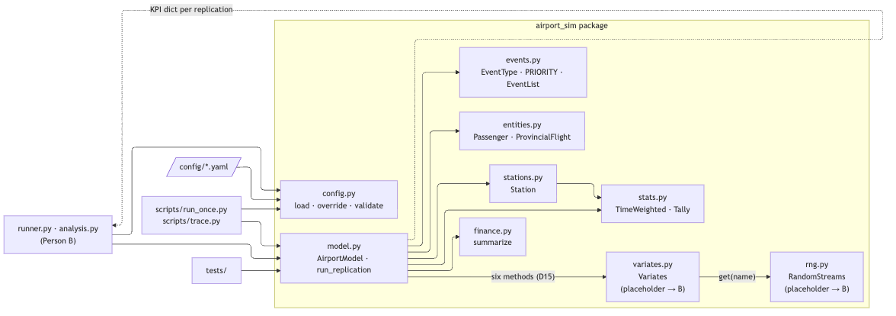

# 6. Model Implementation and Software Architecture

The simulator is written in Python 3.13 and uses **event scheduling with a
hand-written future event list** (D1). No simulation library is used, so every
part of the event logic, queues, resources and statistics is in our own code
and can be traced. Dependencies: numpy (random numbers), PyYAML (config),
SciPy and pandas (output analysis only) and pytest (tests); versions are
pinned in `requirements.txt`. One 7-day baseline replication runs in about
0.1 s, so a 30-replication experiment takes a few seconds.

*Figure 6.1 — Modules and their dependencies. The dashed arrow is the KPI
dictionary returned to the replication runner.*

## 6.1 Modules

| Module | Responsibility | Main contents |
|---|---|---|
| `config/baseline.yaml` | Every parameter of an experiment: horizon and seed, counters and lanes, server-sharing and scenario flags, flight schedules and fares, costs, input-model parameters. Each policy alternative is a short overlay file in `config/alternatives/` that starts with `extends: ../baseline.yaml` and lists only the values that differ (D24). One-off changes can also be given as dotted-key overrides. | — |
| `airport_sim/config.py` | Loads the YAML (following `extends:` chains to the base file), applies overrides such as `{"operations.checkin_counters.coach": 5}` (unknown keys are rejected), and validates the values the event logic relies on. Examples: counters ≤ 6; every passenger class can reach a server; no provincial arrival before t = 0. | `load_config`, `apply_overrides`, `validate_config`, `horizon_minutes` |
| `airport_sim/events.py` | Event types and the future event list. Events are ordered by **(time, priority, sequence number)**, which implements the simultaneous-event rule (D9): security end → check-in end → arrivals → departures → end of run, with ties of the same type in scheduling order. | `EventType`, `PRIORITY`, `EventList.schedule/pop` |
| `airport_sim/entities.py` | Passenger and provincial-flight records with the attributes of §4.2 (type, cabin, flight, lead time, bags, service times, timestamps, status, outcome flags). | `Passenger`, `ProvincialFlight`, status constants |
| `airport_sim/stations.py` | One check-in or security station: two server pools (business and coach), two FIFO queues, the server-sharing rule (D7, D20), and the station's statistics. The model calls `idle_pool_for`, `enqueue`, `start`, `release`, `next_for` and `remove`; the station never schedules events itself. | `Station`, `Station.kpis` |
| `airport_sim/stats.py` | Statistics collectors. `TimeWeighted` accumulates the area under a piecewise-constant curve (queue length, busy servers) and its maximum. `Tally` accumulates per-passenger observations (waits). | `TimeWeighted`, `Tally` |
| `airport_sim/model.py` | The DES itself (§4.5). `AirportModel.run()` is the time-advance loop. There is one routine per event type, matching the event graph node for node (`_initialize`, `_commuter_arrival`, `_provincial_arrival`, `_checkin_end`, `_security_end`, `_commuter_departure`, `_provincial_departure`, `_end`), plus the subroutines `_join_*`, `_start_*`, `_renege` and `_leave`. `run_replication(cfg, replication)` is the entry point for runners. | `AirportModel`, `run_replication` |
| `airport_sim/finance.py` | Per-replication accounting (D12, D13, D25). Takes the revenue, refund and operating-cost accumulators from the model, adds check-in (and optional security) staffing cost, and derives net revenue, profit and the staffing-to-revenue ratio. | `summarize`, `staffing_cost` |
| `airport_sim/rng.py` | One independent PCG64 generator per named stream (six streams), seeded by `SeedSequence(entropy=base_seed, spawn_key=(replication, stream index))`. The seeding procedure is in the module docstring and the README. | `RandomStreams.get(name)`, `seed_record` |
| `airport_sim/variates.py` | Random variates for the six stochastic inputs, behind the interface agreed in D15: exponential interarrivals, binomial bookings, truncated-normal lead time by inverse transform, bag pmf by inverse transform, summed check-in components, exponential screening (§5). | `Variates` |
| `airport_sim/runner.py` | Runs N independent replications of one experiment (replication r = 0 … N−1, same base seed for every experiment) and writes the replication-level CSV plus a `.config.yaml` record of the config file, overrides and N. Command line: `python -m airport_sim.runner --reps N --set key=value --out results/x.csv`. | `run_experiment`, `write_csv` |
| `airport_sim/analysis.py` | Output analysis on a replication CSV: mean, standard deviation, t-based 95% confidence interval and half-width per KPI; the number of replications needed for a target half-width; paired-difference CIs for comparing two systems. | `summarize`, `confidence_interval`, `replications_needed`, `paired_difference_ci` |
| `airport_sim/checks.py` | The passenger-conservation identities, evaluated on one replication's output row (§7.1.2). | `conservation_violations` |
| `scripts/run_once.py` | Runs one replication and prints the KPI dictionary. | — |
| `scripts/trace.py` | Prints an event trace (clock, event, passenger, station and gate state after the event) for a time window, and optionally each passenger's timeline (`--pax-table N`) for hand checking. | — |
| `scripts/check_conservation.py` | Checks the conservation identities on every row of saved replication CSVs. | — |
| `tests/` | pytest suite. Runs every flag combination and several baseline replications with queue/resource invariants checked after each event and passenger conservation checked at the end. Also covers reproducibility, common random numbers across policies, finance identities, the refund rule, deterministic tests of the tie rule, gate capacity and FIFO order, zero arrivals, and each random-variate generator against its theoretical mean. | `helpers.checked_run`, `helpers.FixedVariates` |

## 6.2 How one replication runs

1. `run_replication(cfg, r)` builds `RandomStreams(base_seed, r)` and
   `Variates(cfg["inputs"], streams)`, then `AirportModel(cfg, variates)`.
2. `_initialize()` schedules the first commuter arrival, the first commuter
   departure, every provincial booking's arrival (bookings are drawn at t = 0,
   D18), the first provincial departure, and the end of the run at T.
3. `run()` repeatedly pops the most imminent event, advances the clock to it,
   and calls its routine. Routines change state, update the statistics
   collectors at the moment of each change, and schedule follow-on events.
   The loop stops after the end-of-run event at T. Service completions after T
   are left unprocessed.
4. `_results()` closes the time-weighted statistics at T and returns one flat
   dictionary. It contains the KPIs (§4.8, D14), the financial summary, and
   end-of-run counts used for conservation checks. `runner.py` writes one
   dictionary per replication as one CSV row, and `analysis.py` turns the
   rows into means and confidence intervals.

## 6.3 Design choices

- **Narrow interface between the model and its inputs.** The model only ever
  calls six `Variates` methods (D15). Any object with those methods works,
  which is how the deterministic tests inject fixed service times. The input
  models (`rng.py`, `variates.py`) and the output analysis (`runner.py`,
  `analysis.py`) were developed separately from the event logic and changed
  without touching `model.py`.
- **Common random numbers.** Each random source has its own stream, and a
  passenger's bags and service times are drawn when the passenger is created.
  A given passenger therefore has the same requirements under every policy
  alternative (checked by `test_common_random_numbers_across_policies`), so
  replication r of two alternatives can be compared as a pair.
- **Parameterisation.** Nothing an experiment might change is hard-coded.
  Policy alternatives (counters, lanes, sharing modes, commuter seats or
  frequency) and spec ambiguities (D4, D5, D6) are config values.
- **Statistics are collected where the state changes.** Each queue-length or
  busy-server change calls `TimeWeighted.update` with the event time. Waits are
  tallied when service starts.
- **Traceability.** An optional `trace` callable receives one line per event.
  The tests reuse the same hook to check invariants after every event.
